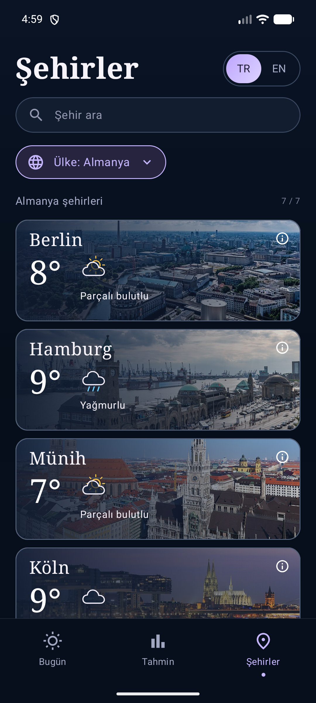

<p align="center">
  
</p>

# HAVA ☀️

Kotlin ve Jetpack Compose ile geliştirilmiş Android hava durumu uygulaması. Türkiye ve dört Avrupa ülkesindeki şehirler için güncel hava durumu, saatlik tahminler ve 7 günlük tahmin sunar.

<p align="center">
  
</p>

## Özellikler

- **Bugün:** Sıcaklık, hissedilen sıcaklık, nem, rüzgâr, yağış olasılığı ve günlük en yüksek UV değeri.
- **Tahmin:** Yaklaşan saatler, 7 günlük sıcaklık aralıkları ve yağış olasılığı grafiği.
- **Şehirler:** Arama, ülke seçimi ve kademeli liste yükleme.
- **109 şehir:** Türkiye'den 81; Almanya, Birleşik Krallık, Fransa ve İtalya'dan 7'şer şehir.
- **TR / EN:** Dil seçimi ve çevrilmiş şehir adları.
- **Uyarlanabilir görünüm:** Dikey ekranda alt gezinme, yatay ekranda gezinme şeridi ve iki sütunlu yerleşim.
- **Şehir fotoğrafları:** Wikimedia API, koordinat kontrolü, yazar ve lisans bilgileri.
- **Önbellek:** Fotoğraf bilgileri 7 gün tutulur; görseller Coil ile saklanır. Ağ hatasında mevcut yerel/önbellekteki fotoğraflar kullanılır.
- **Durum koruma:** Dil, ülke ve seçilen şehir saklanır; ekran döndürülürken arama ve gezinme durumu korunur.

## Kullanılan teknolojiler

| Alan | Teknoloji |
|---|---|
| Dil | Kotlin 2.2.10 |
| Arayüz | Jetpack Compose, Material 3 |
| Mimari | ViewModel, Repository, tek ekran durumu (`LoadState`) |
| Ağ | Retrofit 2.11.0, OkHttp, Gson |
| Asenkron işlemler | Kotlin Coroutines, StateFlow |
| Görseller | Coil 3.3.0 |
| Derleme | Gradle Wrapper 9.6.0, Android Gradle Plugin 9.4.1 |
| SDK | compile/target 37, minimum 24 |

## Kurulum ve çalıştırma

1. Repoyu klonla:

   ```bash
   git clone https://github.com/edanurdomdomoq/BilisimKampi_Hava.git
   ```

2. Android Studio'da `BilisimKampi_Hava` klasörünü aç.
3. Gradle eşitlemesinin tamamlanmasını bekle. SDK Manager üzerinden **Android SDK Platform 37** bileşenini kur.
4. **Gradle JDK** olarak Android Studio'nun gömülü JDK'sını seç. Proje Android Studio JBR 25.0.3 ile doğrulanmıştır.
5. API 24 veya üzeri bir cihaz/emülatör seç ve **app → Run** düğmesine bas.

Kullanılan API uç noktaları için uygulamaya anahtar eklemek gerekmez. Canlı hava durumu ve yeni fotoğrafların alınması internet bağlantısı gerektirir.

`local.properties` her bilgisayarda Android Studio tarafından yerel SDK yoluyla oluşturulur. Bu dosya repoya dahil edilmez.

### Komut satırından derleme

```powershell
.\gradlew.bat :app:assembleDebug
```

macOS / Linux:

```bash
./gradlew :app:assembleDebug
```

Debug APK: `app/build/outputs/apk/debug/app-debug.apk`.

## Proje yapısı

```text
app/src/main/java/com/example/hava/
├── MainActivity.kt          Android yaşam döngüsü ve Compose başlangıcı
├── AppContainer.kt          Uygulama bağımlılıkları
├── model/                   Şehir, tahmin, hava koşulu ve fotoğraf modelleri
├── data/                    Retrofit, DTO dönüşümleri, repository ve önbellek
└── ui/
    ├── LoadState.kt         Loading / Success / Empty / Error
    ├── HavaNavHost.kt       Gezinme ve saklanan ekran durumu
    ├── cities/              Liste, kartlar, ülke seçimi ve CitiesViewModel
    ├── forecast/            Bugün/tahmin ekranları ve ForecastViewModel
    ├── components/          Ortak yükleniyor, boş, hata ve gezinme bileşenleri
    └── theme/               Renk, tipografi ve tema
```

Veri akışı: **Ekran olayı → ViewModel → Repository → Retrofit → DTO → Model → LoadState → Ekran**.

Şehir kartları doğrudan ağ isteği yapmaz. ViewModel tekrar istekleri birleştirir ve kartların hava durumu isteklerini aynı anda en fazla üç tane çalıştırır. Önceki şehrin geç gelen tahmin yanıtı yeni şehrin verisini değiştiremez.

Ayrıntılı rehber: [ARCHITECTURE.tr.md](ARCHITECTURE.tr.md).

## Testler

Son yerel doğrulama: **26 Ekim 2026**, Pixel 8 / API 37.

| Kontrol | Sonuç |
|---|---|
| Debug derlemesi | Başarılı |
| Birim testleri | 18 / 18 geçti |
| Cihaz testleri | 11 / 11 geçti |
| Android Lint | 0 hata, 68 uyarı |
| Canlı şehir fotoğrafı eşleştirmesi | 109 / 109 |

```powershell
# Birim testleri ve statik kontrol
.\gradlew.bat :app:testDebugUnitTest :app:lintDebug

# Bağlı cihaz/emülatör üzerinde testler
.\gradlew.bat :app:connectedDebugAndroidTest
```

UI testleri `WeatherFixtureRule` aracılığıyla kontrollü hava durumu yanıtları kullanır. Ayrı canlı API testleri Open-Meteo yanıtının modele dönüşümünü ve Wikimedia fotoğraflarının indirilmesini doğrular. Canlı testler servis erişimine bağlıdır.

Ayrıntılar: [Test rehberi](docs/TESTING.md).

## Veri ve fotoğraf kaynakları

- Hava durumu: [Open-Meteo](https://open-meteo.com/en/docs).
- Şehir arama uç noktası: [Open-Meteo Geocoding](https://open-meteo.com/en/docs/geocoding-api).
- Şehir fotoğrafları: [Wikipedia PageImages](https://www.mediawiki.org/wiki/API:Pageimages) ve [Wikimedia Commons ImageInfo](https://www.mediawiki.org/wiki/API:Imageinfo).

Her fotoğraf kendi lisansıyla sunulur. Yazar, kaynak ve lisans bağlantıları uygulamadaki **fotoğraf bilgi düğmesinde** ve **Fotoğraf kaynakları** penceresinde gösterilir. Yerleşik görsellerin kaynakları [photo_credits.json](app/src/main/assets/photo_credits.json) dosyasındadır. Fotoğraflar kartlara sığması için kırpılır ve koyu bir katmanla gösterilir.
